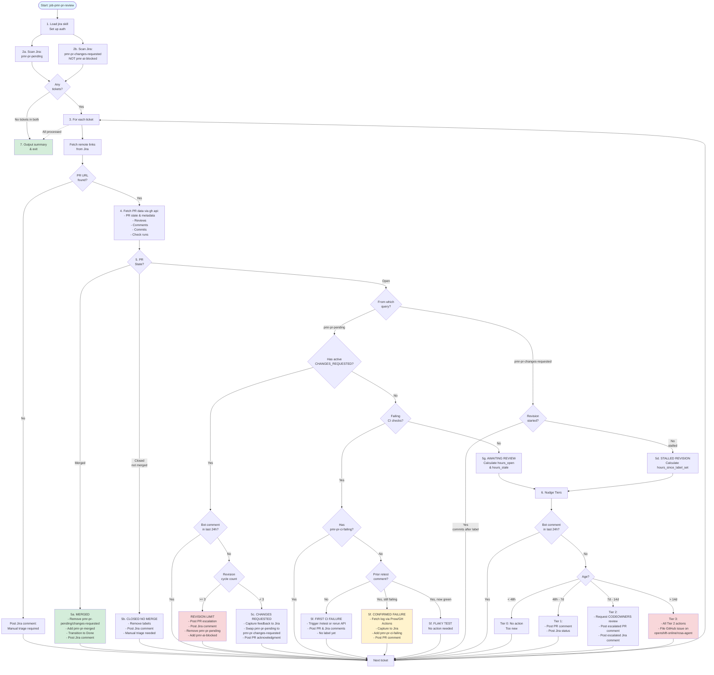

# Job PMR PR Review Workflow

This diagram shows the complete workflow for the `job-pmr-pr-review` skill (MCS-1516/MCS-1517), which monitors and nudges stalled PMR action-item PRs.

## Workflow Overview

The job scans Jira for PMR tickets with open PRs in two states:
- `pmr-pr-pending`: PRs awaiting initial review
- `pmr-pr-changes-requested`: PRs where reviewer feedback was given and a revision run is needed

For each ticket, it checks the GitHub PR state and takes tiered action based on age, CI status, and reviewer feedback.

## Workflow Diagram



## Key Features

### Label Protocol
- `pmr-pr-pending`: PR awaiting initial review
- `pmr-pr-changes-requested`: Reviewer feedback given, revision needed
- `pmr-pr-ci-failing`: CI confirmed failing after retest
- `pmr-pr-merged`: PR merged, ticket complete
- `pmr-ai-blocked`: Revision limit hit or unresolvable blocker

### Escalation Tiers
- **Tier 0** (< 48h): No action, too early
- **Tier 1** (48h - 7d): PR comment + Jira status update
- **Tier 2** (7d - 14d): CODEOWNERS review request + escalated comments
- **Tier 3** (> 14d): All Tier 2 + failure issue filed

### CI Failure Handling
1. First failure → Trigger retest (guard against flaky tests)
2. Still failing after retest → Capture logs, set `pmr-pr-ci-failing`
3. Now passing → Flaky test, no action needed

### Revision Cycle Limit
- Maximum 3 revision cycles per ticket
- On breach: Post escalation comment, set `pmr-ai-blocked`, stop automation
- Requires human triage to continue

## How It Searches Jira

The job uses two separate JQL queries via the Jira REST API (`POST /rest/api/3/search/jql`):

**Query A — Pending PRs:**
```jql
labels = "pmr-pr-pending" AND statusCategory != Done ORDER BY updated ASC
```

**Query B — Changes Requested (potential stalled revisions):**
```jql
labels = "pmr-pr-changes-requested" AND labels NOT IN ("pmr-ai-blocked") AND statusCategory != Done ORDER BY updated ASC
```

Both queries:
- Fetch up to 50 tickets per run
- Order by `updated ASC` (oldest first) to prioritize stalled items
- Exclude `Done` tickets to avoid closed/resolved items
- Query B explicitly excludes `pmr-ai-blocked` (revision limit hit, needs human intervention)

For each ticket found, the job fetches:
- Ticket fields: `summary`, `labels`, `status`, `comment`
- Remote links to find the GitHub PR URL
- Comment history to detect prior bot actions and count revision cycles

## Where Logs Are Captured

All logs and feedback are captured **in Jira as ADF-formatted comments** on the originating ticket:

### 1. Reviewer Feedback (Step 5c — CHANGES_REQUESTED)
When a reviewer requests changes:
- **What's captured:** All review bodies and inline comments, grouped by reviewer
- **Format:** PR URL + title, reviewer login, review body, inline comments (file:line → body)
- **Purpose:** Provides context for `pmr-action-item` revision run
- **Sentinel:** `🤖 PMR PR changes-requested — job-pmr-pr-review`

### 2. CI Failure Logs (Step 5f — Confirmed CI failure)
When CI fails after retest:
- **What's captured:** Last 200 lines of failure log (truncated tail contains actual error)
- **Sources:**
  - **Prow jobs:** Fetched via `https://prow.ci.openshift.org/log?job=<job_name>&id=<job_id>`
  - **GitHub Actions:** Fetched via `gh api repos/<owner>/<repo>/actions/jobs/<job_id>/logs`
- **Format:** PR URL, failing check names, log tail in code block
- **Purpose:** Provides context for `pmr-action-item` CI fix run
- **Sentinel:** `🤖 PMR CI retest triggered — job-pmr-pr-review`

### 3. Status Updates
All state transitions (merged, closed, escalations, retests) are logged to Jira comments for audit trail.

**Why Jira?**
- Central source of truth for PMR action items
- Ticket watchers/assignees are automatically notified
- Persistent context survives PR closure or repository changes
- Searchable via JQL for metrics/debugging

## Where Humans Are Notified

The job notifies humans through multiple channels depending on severity:

### 1. GitHub PR Comments
**Who sees it:** PR author, reviewers, repository watchers

**When posted:**
- **CHANGES_REQUESTED detected** (Step 5c): Acknowledgment that feedback has been logged and revision will be triggered
- **CI retest triggered** (Step 5f, first failure): Notification that retest is running to rule out flakiness
- **CI failure confirmed** (Step 5f, after retest): Notification that log has been captured and fix run will be triggered
- **Tier 1 nudge** (48h–7d, Step 6): Polite reminder that PR is awaiting review
- **Tier 2 escalation** (7d–14d, Step 6): Urgent reminder with CODEOWNERS review request
- **Tier 3 escalation** (>14d, Step 6): Critical reminder indicating failure issue has been filed
- **Revision limit reached** (3 cycles, Step 5c): Notification that automation has stopped, human triage required

All PR comments include the sentinel `🤖 PMR PR review nudge` or `🤖 PMR PR changes-requested` for deduplication (prevents spam within 24h).

### 2. Jira Comments
**Who sees it:** Ticket assignee, watchers, SREs monitoring PMR pipeline

**When posted:**
- All state transitions (merged, closed, changes-requested, CI failures)
- Status updates for each nudge tier
- Escalation notices (revision limit, stalled revisions)
- Captured logs and reviewer feedback (see above)

### 3. CODEOWNERS Review Requests
**Who gets requested:** Individual logins from repository CODEOWNERS file (Tier 2 escalation)

**When triggered:**
- PR has been open 7–14 days with no review
- Revision has stalled 7–14 days with no commits

**How it works:**
- Fetches `CODEOWNERS` file via `gh api repos/<owner>/<repo>/contents/CODEOWNERS`
- Parses `*` catch-all line for logins
- Requests review via `gh api repos/<owner>/<repo>/pulls/<pr-number>/requested_reviewers`
- Team slugs require org admin access and may be blocked by policy

### 4. GitHub Issues (Escalations & Failures)
**Where:** `openshift-online/rosa-agent` repository

**Who sees it:** rosa-agent maintainers, oncall SREs

**When filed:**
- **Tier 3 escalation (>14 days):** PR stalled over 14 days, includes ticket key, PR URL, age, nudges sent
- **Job failure:** Any unrecoverable error (auth failure, policy denial, unexpected API error), includes stage, ticket, PR, command, error output

**Title format:**
- Escalation: `PMR PR stalled >14 days: <JIRA-KEY>`
- Failure: `job-pmr-pr-review failure: <one-line summary>`

All issues include sentinel `🤖 Filed by job-pmr-pr-review` or `🤖 Filed automatically by a failed job-pmr-pr-review run.`

### 5. Deduplication Rules
To avoid notification spam:
- **PR comments:** Skipped if bot comment with matching sentinel posted within last 24 hours
- **Jira comments:** Posted for each state transition but throttled by 24h dedup for nudges
- **CODEOWNERS requests:** Only sent once per escalation tier
- **GitHub issues:** Only filed once per ticket per tier/failure

## Related
- **Source**: `sandbox/skills/job-pmr-pr-review/SKILL.md`
- **Tickets**: MCS-1516 (initial), MCS-1517 (resilience)
- **Pipeline**: Part of PMR action pipeline (MCS-46)
